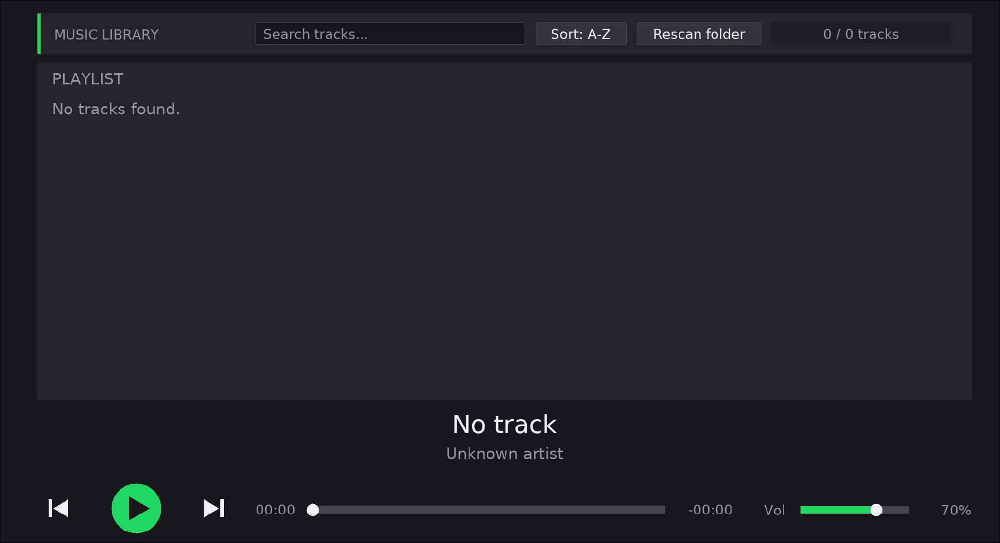

# Sonora

**A lightweight, fast and minimal MP3 player for Linux**


---

## Screenshot



## Features

- 🎵 Automatically scans your music folder and builds a playlist
- 🔍 Instant search through your tracks
- 🔤 Sorting (A-Z and more)
- 🔄 Rescan folder button to pick up newly added music
- 🏷️ Reads track metadata (title and artist) via TagLib
- ⏯️ Play / pause, previous and next track controls
- ⏱️ Seek bar with elapsed and remaining time
- 🔊 Volume control with percentage display
- 🗂️ Native folder selection dialog (Zenity)
- 🖥️ Desktop integration: application menu entry and icon
- 🪶 Lightweight and fast, written in C with SDL2

## Dependencies

Sonora is built with:

- [SDL2](https://www.libsdl.org/)
- [SDL2_mixer](https://github.com/libsdl-org/SDL_mixer)
- [SDL2_ttf](https://github.com/libsdl-org/SDL_ttf)
- [TagLib](https://taglib.org/) (C bindings)
- [Zenity](https://gitlab.gnome.org/GNOME/zenity)
- GCC, Make, pkg-config

All dependencies are installed automatically by the install script on supported distributions.

## Installation

Supported package managers: `apt` (Debian / Ubuntu), `dnf` (Fedora), `pacman` (Arch Linux).

```bash
git clone https://github.com/YOUR_USERNAME/sonora.git
cd sonora
chmod +x install.sh
./install.sh
```

The script will:

    1. Install all required dependencies
    2. Build Sonora with `make`
    3. Install the executable to `/usr/local/lib/sonora`
    4. Create the `sonora` launcher in `/usr/local/bin`
    5. Install the icon and add Sonora to your application menu

> **Note:** `sudo` is required for installing packages and system files.
> On Arch Linux the script runs `pacman -Syu`, which may upgrade other installed packages.

### Manual build

If you prefer to build it yourself, install the dependencies listed above and run:

```bash
make
./player /path/to/your/music
```

## Usage

Launch Sonora from your application menu, or from the terminal:

```bash
sonora
```

By default Sonora opens your system music directory (`xdg-user-dir MUSIC`), falling back to `~/Music`.

To open a specific folder:

```bash
sonora /path/to/music
```

## Uninstall

```bash
chmod +x uninstall.sh
./uninstall.sh
```

The script removes the Sonora executable, launcher, icon and desktop entry.

The following are **not** removed:

- Your music files
- Your personal files and folders
- Shared system dependencies (SDL2, TagLib, Zenity, etc.)

## Contributing

Contributions, issues and feature requests are welcome!
Feel free to open an [issue](https://github.com/Luckyduggy/Sonora/issues) or submit a pull request.

## License

This project is licensed under the MIT License. See the [LICENSE](LICENSE) file for details.

---

Made with ❤️ and C